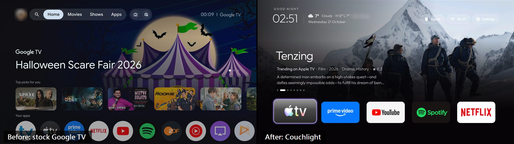
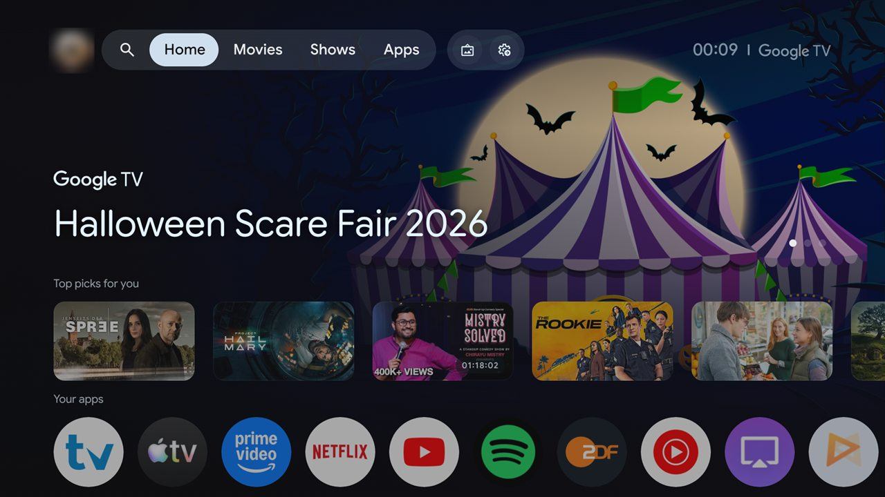
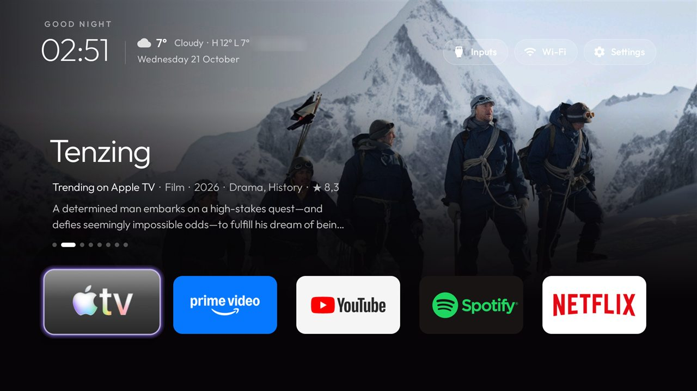
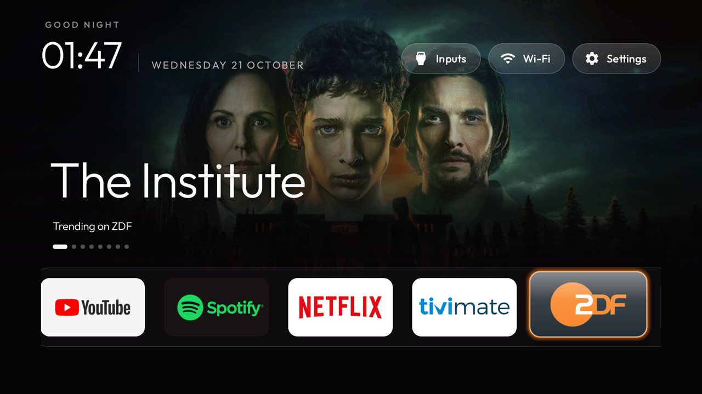
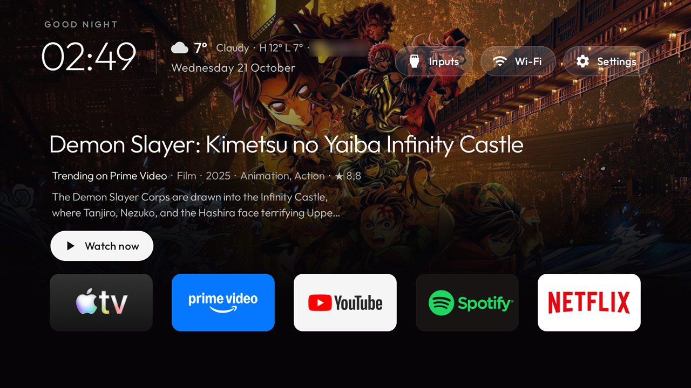
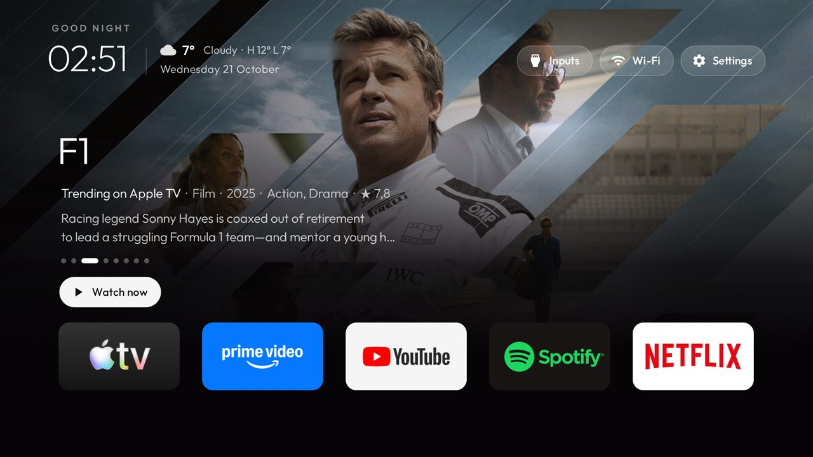
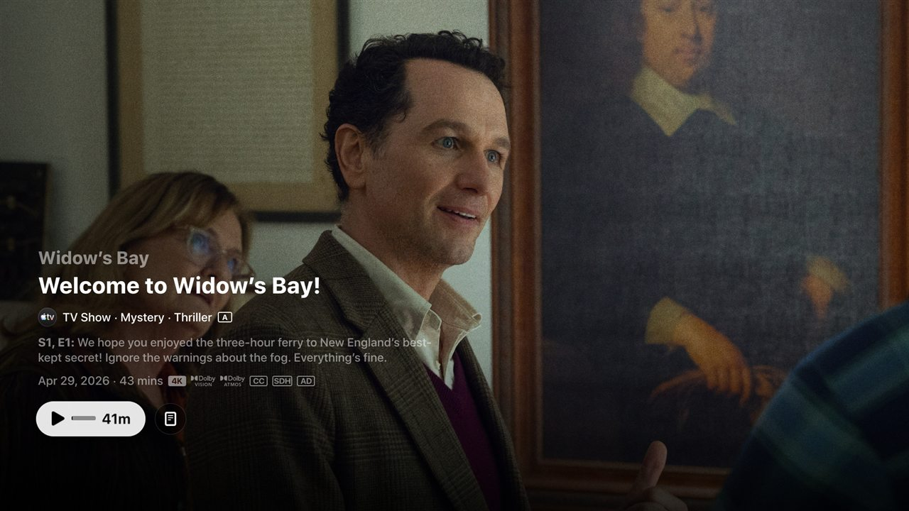
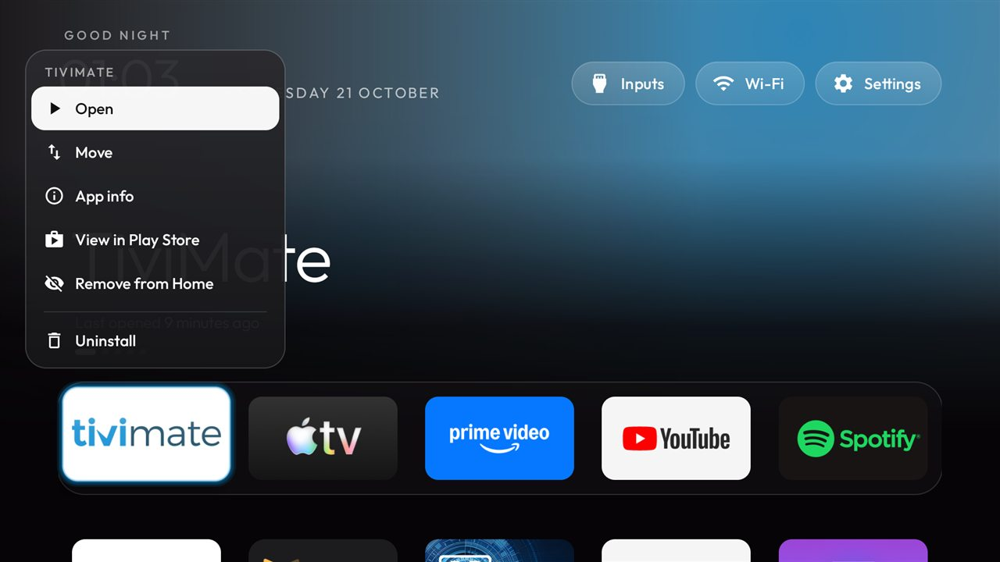
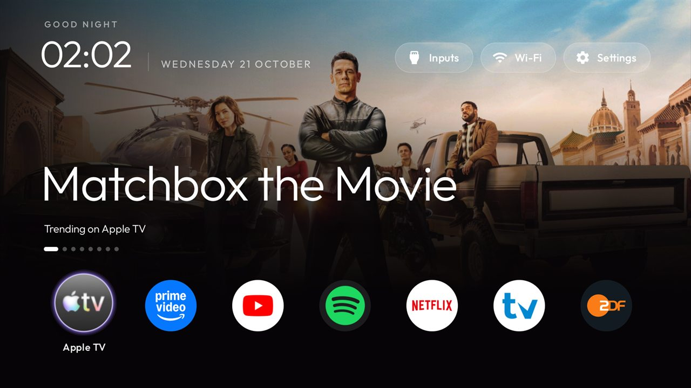

<h1 align="center">Couchlight tvOS</h1>

<p align="center">
  <b>Your TV's home screen, lit by what's on.</b><br>
  Debloat any Android TV or Google TV over Wi-Fi, then replace its ad-filled home with one clean row of apps
  under a full-screen backdrop of what each app is playing or what's trending on it, with a <b>Watch now</b>
  button that opens the title right inside its app.
</p>

<p align="center">
  <a href="https://github.com/globetrottingengineer/couchlight/actions/workflows/ci.yml"></a>
  
  
  
  <a href="LICENSE"></a>
</p>

<p align="center">
  
</p>

---

## Contents

- [Why Couchlight](#why-couchlight)
- [Before and after](#before-and-after)
- [What you get](#what-you-get)
- [Using it with the remote](#using-it-with-the-remote)
- [What you need](#what-you-need)
- [Setting it up](#setting-it-up)
- [Settings you can change](#settings-you-can-change)
- [Privacy](#privacy)
- [Undo everything](#undo-everything)
- [How it works](#how-it-works)
- [Project layout](#project-layout)
- [Troubleshooting](#troubleshooting)
- [Credits and licence](#credits-and-licence)

## Why Couchlight

A stock Google TV home is an ad surface first: promoted banners, "top picks" from services you don't pay for,
sponsored rows, and analytics from both Google and the TV maker. The apps you actually use sit in a strip at
the bottom.

Couchlight turns that around:

- **Your apps are the home screen.** One row, in your order, nothing promoted.
- **The backdrop shows *your* services.** What Netflix, Prime Video, Apple TV or ZDF has that's new and popular
  in your country, or what you were just watching, with the title's details, like Google TV's banner but
  without the ads.
- **Watch now opens the title, not a search.** OK on a title takes you to its own page inside the app.
- **The bloat goes away and can come back.** Telemetry, ad services and preloaded junk are *disabled*, never
  uninstalled, and a restore script puts everything back.

It was vibe-coded in one evening with Claude Code on a JMGO S91A projector, on top of
[CleanYourTV](https://github.com/Gathin23/cleanyourtv) (see [Credits](#credits-and-licence)).

## Before and after

| Stock Google TV | Couchlight-tvOS |
|---|---|
|  |  |
| A promotion banner, picks from Google, apps pushed to the bottom | The focused app's own content, your apps in one row |

## What you get

### A backdrop of what's on, for every app



Move along the row and the whole screen changes with the app:

- **Now playing:** for apps that are playing or paused (Spotify, YouTube and others), you get the artwork and
  title, read from Android's media sessions.
- **Trending:** for streaming services, the most popular recent shows and films on that service in your
  country, from TMDB. Titles rotate every 9 seconds. Built in: Netflix, Prime Video, Apple TV, Disney+, Max,
  Paramount+, Hulu, Peacock, Crunchyroll, Hotstar, MUBI, Sky, RTL+, ZDF, ARD and Arte.
- **Everything else:** the app's own artwork, softened into a coloured glow.

### Title details, like Google TV



Each title shows:
- **Info line:** what kind it is, the year, two genres and the TMDB rating, for example *Film · 2025 · Animation,
  Action · ★ 8.8*.
- **Description:** two lines of the plot.
- **Long titles:** they shrink to fit instead of being cut off.

### Watch now, inside the app

| Up on an app focuses Watch now | OK opens the title's own page |
|---|---|
|  |  |

From any app with titles:
- **Up** focuses **Watch now**.
- **Left / Right** flip through that app's titles; the dots show where you are.
- **OK** opens the title's page *inside the app*. Couchlight looks the title up on JustWatch and uses the link the
  app itself answers: `tv.apple.com/…`, `netflix.com/title/…` or `watch.amazon.de/…`. If none fits, it opens
  the app's own search for the title, or failing that the app.

### Hold OK for the app menu



Hold OK on any app for a menu that floats over its tile:
- **Open**
- **Move:** arrows move the tile, OK puts it down.
- **App info**
- **View in Play Store**
- **Remove from Home:** the app stays installed, and the App library adds it back.
- **Uninstall:** only for apps you installed yourself, and Android asks you to confirm.

### Weather, clock and date

The top-left shows the time, the weather (an icon, the temperature, the sky, today's high and low, and your city)
and the date. Weather comes from Open-Meteo with no account needed, and the city from your connection.

### Your look



- **Tiles:** rectangle banners, or round icons like Google TV and tvOS (`round_tiles`).
- **Dock band:** a lighter band behind the row, or none (`dock_band`).
- **Background:** a time-of-day sky that warms at sunrise and sunset.
- **Themes:** themes and wallpapers without rebuilding ([themes/README.md](themes/README.md)).
- **Screensaver:** a clock that drifts so nothing burns in.

## Using it with the remote

| On an app | Does |
|---|---|
| **Left / Right** | Move along the row; the backdrop follows |
| **OK** | Open the app |
| **Hold OK** | App menu: Open, Move, App info, Play Store, Remove from Home, Uninstall |
| **Up** | Watch now for the app's titles (or the top bar when it has none) |

| On Watch now | Does |
|---|---|
| **Left / Right** | Previous / next title |
| **OK** | Open the title in its app (Resume for something playing) |
| **Down / Back** | Back to the app row |
| **Up** | Inputs, Wi-Fi and Settings |

At the top bar:
- **Inputs:** opens HDMI and AV.
- **Wi-Fi:** shows the network.
- **Settings:** opens the TV's settings. Hold OK on it for the launcher's own settings, reordering and the App
  library.

## What you need

- **A TV:** any **Android TV or Google TV** on Android 8.0 or newer, including TVs, projectors and streaming
  boxes. Tested on a JMGO S91A, and the [`examples/`](examples/) folder has debloat lists for **124 TV models**.
  Not for Samsung (Tizen), LG (webOS) or Fire TV.
- **A computer:** Windows, macOS or Linux, on the same Wi-Fi as the TV.
- **To build the launcher:** JDK 17 and the Android SDK (platform 34, build-tools 34). Android Studio includes
  both, or use the command-line tools.
- **For trending content (optional):** a free [TMDB API key](https://www.themoviedb.org/settings/api). Without
  one, everything else still works.
- **Optional:** a coding assistant with shell access (Claude Code, Codex, Gemini CLI) can do every step below
  for you from [`PROMPT.md`](PROMPT.md).

## Setting it up

> Short version: open a coding assistant in this folder, paste [`PROMPT.md`](PROMPT.md), name your TV and
> answer its questions. The steps below are the same thing by hand.

### 1. Turn on debugging on the TV

1. **Developer options:** Settings → System (or Device Preferences) → About → press OK on **Build** seven times.
2. **Debugging:** go back to Developer options and turn on **USB debugging**. Turn on **Wireless / network
   debugging** too if your TV has it.
3. **Note the address:** write down the TV's IP address (Settings → Network).

### 2. Connect and back up

Install the tools' Python environment once:

```bash
python3 -m venv tools/venv && tools/venv/bin/pip install -r tools/requirements.txt
```

On Windows: `python -m venv tools\venv; tools\venv\Scripts\python.exe -m pip install -r tools\requirements.txt`

```bash
TV_HOST=192.168.1.50 tools/venv/bin/python -I tools/tv.py --probe
```

The TV asks **"Allow USB debugging?"**: tick *Always allow* and choose Allow. The probe prints the model and
Android version.

### 3. Debloat

Find your TV in [`examples/`](examples/), or one from the same brand and Android version, read its header and
comment out anything you use. Then:

```bash
TV_HOST=192.168.1.50 tools/disable.sh examples/jmgo-s91a-lonavla/debloat.txt
```

On Windows: `tools\disable.ps1 -TvHost 192.168.1.50 examples\jmgo-s91a-lonavla\debloat.txt`

The script records the TV's state first, so [Undo everything](#undo-everything) can put it back.

### 4. Build and install Couchlight

1. **TMDB key (optional):** put it in `launcher/local.properties`, which git ignores, so the key never lands in a
   commit:

   ```properties
   sdk.dir=/path/to/Android/Sdk
   tmdb.api.key=your_tmdb_key
   ```

2. **Choose your dock:** set the apps that come first in the row in
   [`config.xml`](launcher/app/src/main/res/values/config.xml) (`dock_apps`), and adjust anything else from
   [Settings you can change](#settings-you-can-change).

3. **Build and install:**

   ```bash
   TV_HOST=192.168.1.50 launcher/build-and-install.sh
   ```

   On Windows: `launcher\build-and-install.ps1 -TvHost 192.168.1.50`

   The script builds the APK, installs it, enables the media listener for "Now playing", makes Couchlight the
   Home app and turns the stock launcher off. If Home doesn't come up, it puts the stock launcher back.

### 5. Switch debugging off again

On the TV:
1. Go to Developer options and choose **Revoke USB debugging authorisations**.
2. Turn **Wireless debugging** and **USB debugging** off.
3. Restart the TV.

Network ADB is unencrypted, so don't leave it on. Couchlight keeps working without it.

## Settings you can change

All of these live in [`launcher/app/src/main/res/values/config.xml`](launcher/app/src/main/res/values/config.xml).
A theme's `config.json` can override any of them without rebuilding.

| Key | Default | What it does |
|---|---|---|
| `dock_apps` | TiviMate, Apple TV, Prime Video, YouTube, Netflix | Apps that come first in the row, in order |
| `single_row` | `true` | One sideways-scrolling row of every app; `false` for a dock plus grid |
| `columns` | `5` | Tiles across the screen (7 suits round tiles) |
| `round_tiles` | `false` | Round icons instead of rectangle banners |
| `dock_band` | `false` | Lighter band behind the row |
| `cinematic_home` | `true` | Full-screen backdrop behind the focused app |
| `content_shelf` | `true` | Now playing and trending content in the backdrop |
| `content_cards` | `false` | Up opens a row of title cards instead of Watch now |
| `content_region` | TV's locale | Country for the streaming catalogues (`DE`, `US`, `IN`) |
| `weather` | `true` | Weather above the date |
| `sky_intensity` | `60` | Time-of-day sky behind everything (0 to 100) |
| `advanced_effects` | `true` | Lifted tiles, smooth colour changes |
| `app_library` | `true` | App library, to add or remove apps from Home |

The TMDB key is not in this file but in `launcher/local.properties` (`tmdb.api.key`).

## Privacy

With no TMDB key, Couchlight makes no requests except the weather's. With a key, this is everything it sends:

| Service | When | What |
|---|---|---|
| [TMDB](https://www.themoviedb.org) | Once per app every 6 hours | The trending query, your key and country |
| [JustWatch](https://www.justwatch.com) | When you press OK on a title | That title's name and your country |
| [ipapi.co](https://ipapi.co) | Once a day | Your connection's IP, to find your city for the weather |
| [Open-Meteo](https://open-meteo.com) | Every 30 minutes | A latitude and longitude rounded to about 100 m |

It reads media sessions only to show what's playing, and never reads notifications. Nothing is sent to the
project or anyone else. Switch `weather` or `content_shelf` off and those requests stop.

## Undo everything

Turn debugging on again, then:

```bash
TV_HOST=192.168.1.50 tools/restore.sh examples/jmgo-s91a-lonavla/debloat.txt com.google.android.apps.tv.launcherx
```

On Windows: `tools\restore.ps1 -TvHost 192.168.1.50 examples\jmgo-s91a-lonavla\debloat.txt`

This re-enables every package the list turned off and gives Home back to the stock launcher. To remove
Couchlight itself, go to Settings → Apps on the TV.

## How it works

1. **Debloat over ADB.** Android TVs have the same debug bridge as phones. The tools disable packages with
   `pm disable-user`, one batch at a time, after recording what was on, so nothing is uninstalled and a restore
   is one command.
2. **A native launcher.** About 430 KB, plain Java and Android views, no web views, built for TVs with 1 GB of
   memory. It takes over Home with `cmd package set-home-activity`.
3. **Content from public sources.** Google TV's own content rows come from a database only apps built into the
   TV's firmware may read (`ACCESS_ALL_EPG_DATA` is signature-level). So Couchlight brings its own:
   - **Media sessions:** for what's playing.
   - **TMDB:** for what's trending on each service.
   - **JustWatch:** for each title's link inside its app.

   Lists and pictures are cached, so the home screen still works offline.

## Project layout

```
launcher/           the Couchlight launcher (Android app, package com.gathin.tvhome)
  app/src/main/java/com/gathin/tvhome/
    MainActivity.java    home screen, row, shelf, Watch now, app menu
    ContentShelf.java    now playing, TMDB trending, JustWatch title links
    Weather.java         ipapi.co place + Open-Meteo weather
    RoundIcon.java       round icon tiles
  app/src/main/res/values/config.xml   every switch listed above
  build-and-install.sh / .ps1          build, install, make it Home
tools/              ADB client, disable / restore scripts, themes
examples/           debloat lists for 124 TVs, one folder per model
themes/             ready-made themes (aurora, six-columns, …)
docs/               guides; docs/couchlight/ has the screenshots above
PROMPT.md           the prompt for a coding assistant
CLEANYOURTV.md      the original CleanYourTV README (also in Chinese)
```

## Troubleshooting

- **"Allow USB debugging?" never appears.** Turn USB debugging off and on, then connect again. Some TVs only
  offer Wireless debugging with a pairing code; `PROMPT.md` covers pairing.
- **Home crash-loops or the stock home comes back.** On Google TV the setup wizard (`setupwraith`) also claims
  Home. Add it to your list, but first check that it doesn't own your saved Wi-Fi network: forget the network
  and join it again before disabling it.
- **No trending titles.** Check `tmdb.api.key` in `launcher/local.properties` and rebuild. YouTube, IPTV players
  and apps TMDB doesn't list show their own artwork instead.
- **"Now playing" never shows.** The launcher needs its media listener enabled. `build-and-install` does this,
  but some TVs switch it off with debugging. Re-run the install, or run
  `cmd notification allow_listener com.gathin.tvhome/com.gathin.tvhome.MediaListener` over ADB.
- **Watch now opens the app's start screen.** JustWatch had no link for that title on that service, and the app
  takes no search link.

There's more in [docs/TROUBLESHOOTING.md](docs/TROUBLESHOOTING.md).

## Credits and licence

Couchlight is built on **[CleanYourTV](https://github.com/Gathin23/cleanyourtv) by Gathin**. The ADB tools, the
debloat lists from its community, the launcher's foundations (dock, glass highlight, themes, screensaver, 19
languages) and the prompt all come from there, and so did the inspiration. Its README is kept as
[CLEANYOURTV.md](CLEANYOURTV.md) ([中文](CLEANYOURTV.zh-CN.md)).

- **Licence:** MIT, like CleanYourTV. See [LICENSE](LICENSE). CleanYourTV © 2026 Gathin; Couchlight's changes
  © 2026 the Couchlight contributors, under the same licence.
- **TMDB:** trending lists and images come from [TMDB](https://www.themoviedb.org). *This product uses the TMDB
  API but is not endorsed or certified by TMDB.*
- **Other services:** title links come from [JustWatch](https://www.justwatch.com), weather from
  [Open-Meteo](https://open-meteo.com) and the approximate location from [ipapi.co](https://ipapi.co).
- **Font and screenshots:** the font is [Outfit](https://fonts.google.com/specimen/Outfit) (OFL). The
  screenshots show titles' publicity art from TMDB and app logos, which belong to their owners.
